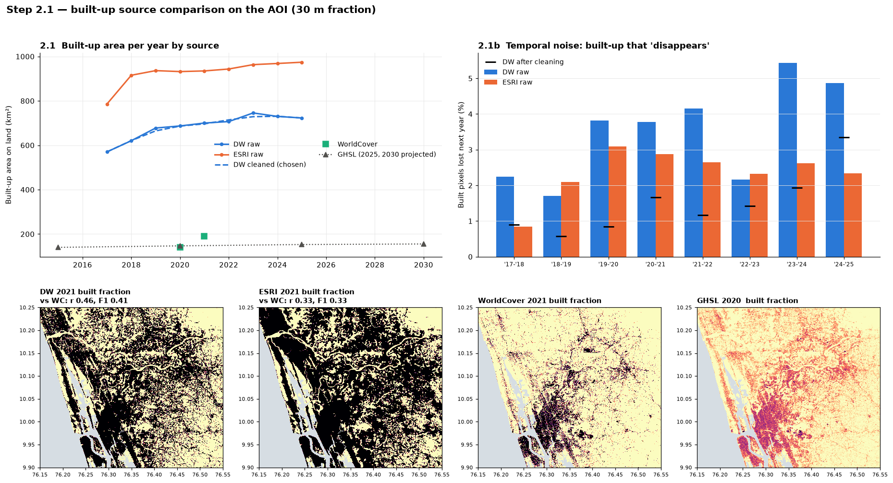
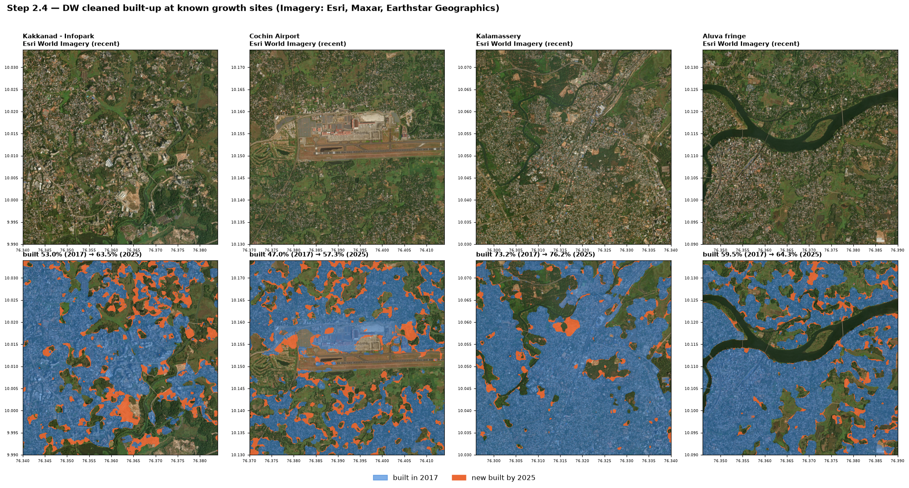
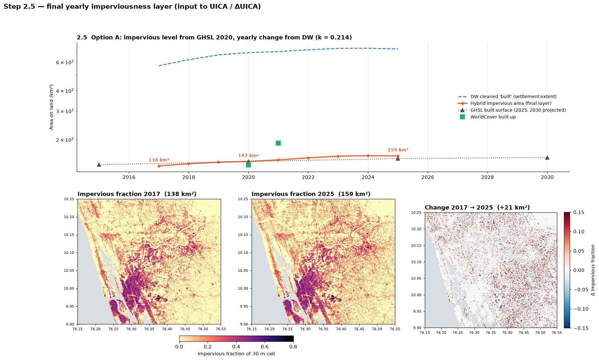
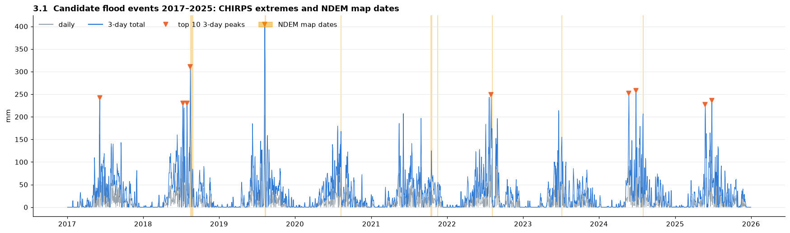
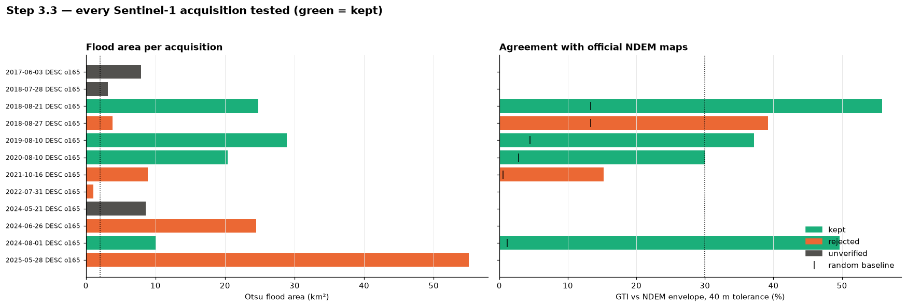
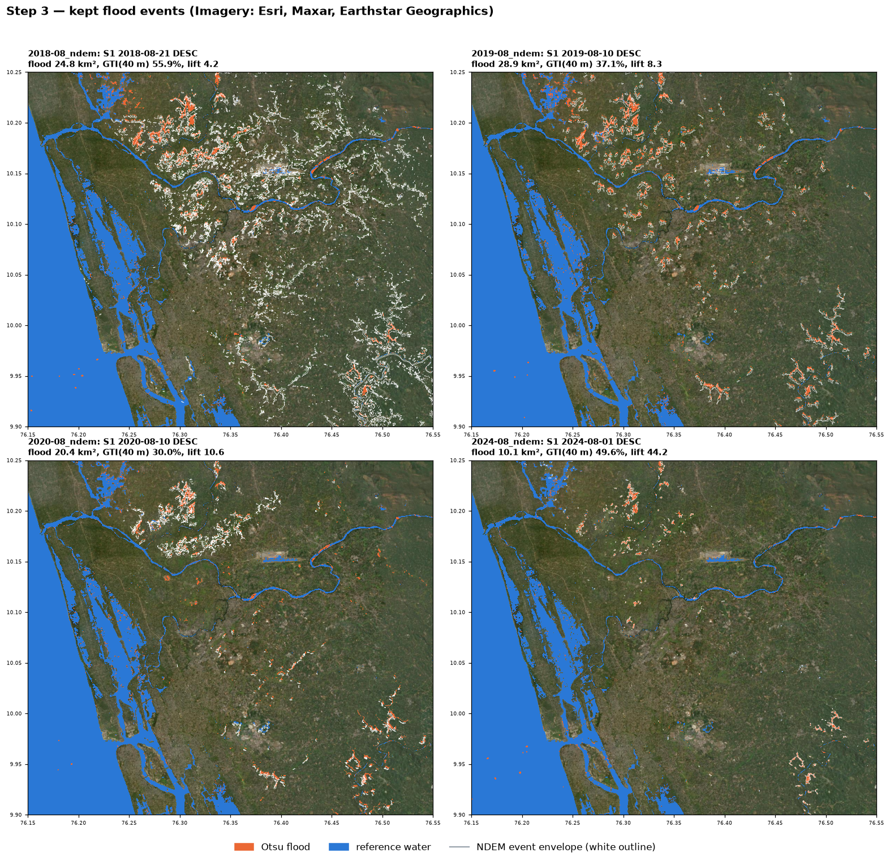

# Phase 2: Week 0 and Week 1 work, explained

**Project:** Development-aware flood susceptibility mapping, Lower Periyar (Aluva–Kochi), Kerala<br>
**Team 67:** Albin John, Niketh B Nath, Jatin Nath, R Ranjith Kumar · **Guide:** Dr. Rosebell Paul<br>
**Covers:** Phase 2 Steps 1, 2 and 3 (Week 0 kickoff and Week 1 data work)

This document explains, in plain language, what we did in the first part of Phase 2, why we did it, and what came out. Every figure shown here is an actual output of our scripts. Each section ends with the questions the guide is likely to ask, and their answers.

---

## 0. The big picture in one minute

Phase 1 gave us a working flood-susceptibility model: LightGBM on 11 terrain and water features, trained on the 2018 flood. The model has one big gap: **it cannot see development.** It knows nothing about buildings, roads or paved land, so it cannot answer the main question of our project:

> *"If this area keeps getting built up, how does flood risk change?"*

Phase 2 fixes that. Before any new modelling, we needed three foundations, and building them is what Weeks 0 and 1 were about:

| Step | Question it answers | Result in one line |
|---|---|---|
| **Step 1** (Week 0) | Can we still reproduce Phase 1 exactly, so that every Phase 2 improvement is measured fairly? | Yes: 10 / 10 checks identical (AUC 0.9993, 88.5 % on unseen areas) |
| **Step 2** (Week 1) | How much land is paved or roofed in each year from 2017 to 2025? | An imperviousness map for every year: **138 km² (2017) → 159 km² (2025)**, +21 km² |
| **Step 3** (Week 1) | Can we find more real flood events than the single 2018 flood? | **4 verified flood events** (2018, 2019, 2020, 2024), up from 1 used in Phase 1 |

These three results feed directly into Week 2, where we build the new **UICA** feature (Upstream Impervious Contributing Area: how much paved land drains into each place).

---

## Words we use (glossary)

| Term | Simple meaning |
|---|---|
| **AOI** | Area of interest: our 1,697 km² study box around Aluva–Kochi. |
| **30 m grid** | The map is cut into 30 m × 30 m squares (cells). Every number we compute is per cell. |
| **Sentinel-1 (S1)** | A European radar satellite. Radar sees through clouds, which matters in the monsoon. Calm water looks dark in radar images. |
| **Orbit / pass** | S1 passes over us going north (ascending) or going south (descending). Images from the same orbit are directly comparable. |
| **Otsu threshold** | An automatic method that finds the brightness value separating "dark = water" from "bright = land". |
| **Dry reference** | A radar image of the same place in the dry season (Jan–Apr). Water present in both images is permanent (sea, backwaters, river), not flood. |
| **NDEM** | National Database for Emergency Management (NRSC/ISRO). It holds the official government flood maps, which we use as our "answer key". |
| **GTI** | Ground Truth Index: the share of our flood pixels confirmed by the official NDEM map (within 40 m). Higher is better. |
| **Lift** | How many times better than a random map. GTI 50 % with a random score of 1 % gives a lift of 50. |
| **CHIRPS** | A satellite-based daily rainfall dataset. |
| **Built-up / impervious** | Land covered by roofs, roads or paving, where rain cannot soak in, so it runs off. |
| **Dynamic World (DW), ESRI, WorldCover, GHSL** | Four different satellite land-cover products that tell us where buildings are. |
| **GEE** | Google Earth Engine: the cloud platform we used to download all satellite data. |

---

## Step 1 (Week 0): Freezing the Phase 1 baseline

### Why we did this

Phase 2 claims improvements such as "UICA improves accuracy by X". That claim is only valid if the Phase 1 model is exactly the same as before. If any number had silently changed, we could not tell whether a later gain came from our new idea or from an accident.

### What we did

1. **Saved a permanent bookmark of Phase 1 in git** (a tag named `phase1-final`). We can always return to the exact Phase 1 code.
2. **Created the Phase 2 folder structure,** the same as Phase 1: `scripts/`, `docs/`, `data/`, `outputs/maps`, `outputs/metrics`, `outputs/models`.
3. **Collected all reusable Phase 1 code into one shared file, `common.py`.** Phase 2 scripts now import the flow-routing algorithm, the flood-mapping chain, the GTI calculation, the accuracy metrics and the map helpers from this one file, instead of copy-pasting them. We also added one new function, *weighted flow accumulation*, which Week 2 needs for UICA.
4. **Ran a checkpoint:** recomputed Phase 1 results using only `common.py` and compared them with the saved Phase 1 outputs.

### Result: everything identical

| What we re-checked | Phase 2 result | Phase 1 value | Same? |
|---|---|---|---|
| Land / water mask | 1,640,815 land cells | same | ✅ |
| Flow accumulation (water routing) | max difference 0.0 | Step 7 raster | ✅ |
| TWI (wetness index) | max difference 0.0 | Step 7 raster | ✅ |
| Flood labels on the 30 m grid | area error 0 | exact | ✅ |
| GTI for 2018 | 58.44 % | 58.44 % | ✅ |
| Model training rounds | 648 | 648 | ✅ |
| Test accuracy / AUC | 99.06 % / 0.9993 | 99.06 % / 0.9993 | ✅ |
| All 9,171 individual test predictions | difference 0.0 | Step 9 file | ✅ |
| Accuracy on unseen 10 km areas | 88.49 % (AUC 0.979) | 88.49 % | ✅ |

**10 out of 10 checks passed, in about 30 seconds.** Our Phase 1 baseline is frozen and can be reproduced exactly.

### Likely questions

- **"Why not just keep using the Phase 1 scripts?"** Phase 2 needs the same functions in many new scripts. Copies drift apart over time; one shared file cannot. The checkpoint proves that the shared file is exactly equivalent.
- **"Which number will you compare against?"** We will mainly use the honest one, 88.5 % on unseen 10 km areas, and not the 99 % from a random split. In Phase 1 we showed that the 99 % comes from training and test pixels sitting right next to each other.

---

## Step 2 (Week 1): How much land is built-up or paved each year?

### Why we need this

When it rains on soil or trees, much of the water soaks in. When it rains on a roof or a road, almost all of it runs off into drains and low ground. More paved land upstream means more water arrives downstream. To measure that (UICA, in Week 2), we first need a map of **impervious (paved or roofed) area for every year**, with the same meaning in every year so that the change between years is real.

### 2.1 We compared four satellite sources

| Source | What it gives | Years |
|---|---|---|
| **Dynamic World (Google)** | A land-cover label for every 10 m pixel in every image; we took the most common label per year | 2017–2025, yearly |
| **ESRI annual land cover** | One 10 m land-cover map per year | 2017–2025, yearly |
| **ESA WorldCover** | The most accurate 10 m map, but only two years | 2020, 2021 |
| **GHSL (EU JRC)** | Built-up *surface area* inside each 100 m cell (actual roof and paving area) | 2015, 2020, plus projections for 2025 and 2030 |

**Putting them on our grid exactly.** We downloaded every source onto a ~10 m grid chosen so that **exactly 3 × 3 small cells fit inside each 30 m model cell.** The built-up fraction of a 30 m cell is then simply "how many of its 9 small cells are built", divided by 9. No approximation is involved.



*Top left: built-up area per year from each source. Top right: how much "built" area disappears from one year to the next (noise). Bottom: the 2021 maps side by side.*

### 2.2 The surprising finding: two meanings of "built"

The sources disagreed by four to five times:

| Source | Built-up on land | Share of land |
|---|---|---|
| Dynamic World | 570 → 723 km² | 39 % → 50 % |
| ESRI | 786 → 974 km² | 54 % → 67 % |
| WorldCover | 140–191 km² | 10–13 % |
| GHSL | 140–155 km² | 10–11 % |

To find out why, we looked at the maps over real satellite photos of four places that are known to have grown: **Kakkanad–Infopark, Cochin Airport, Kalamassery and the Aluva fringe.**



*Top row: satellite photo. Bottom row: Dynamic World "built" in 2017 (blue) and new "built" by 2025 (orange).*

**What the photos show:** in Kerala, houses are spread out under coconut and other trees, with gardens around each one. Dynamic World and ESRI label this whole mixed "village fabric" as built. That is **settlement extent**: the places where people live. WorldCover and GHSL instead measure the **actual roofs and roads**, which cover only about 10–13 % of the land.

For flooding, what matters is the area where water cannot soak in: the roofs and roads, not the trees between them. Using Dynamic World directly would tell the model that half of the study area is concrete, which is about **4 times too much**.

### 2.3 Cleaning the yearly series

Satellite classifiers make random mistakes. A pixel might be labelled "built" in 2019, "not built" in 2020 and "built" again in 2021. Buildings almost never disappear and come back, so this is noise.

**What we did:**

- **Majority-of-3-years filter.** For every year, each pixel takes the majority value of (previous year, this year, next year).
    - "Built, not built, built" becomes built in all three years.
    - "Not built, built, not built" becomes not built in all three years.
- **Effect.** The share of built pixels that "disappear" each year fell from **3.5 % to 1.5 %**. The first year (2017) and the last year (2025) have only one neighbouring year, so they cannot be filtered. We say so openly.

### 2.4 Our decision: Option A, the hybrid

We took the best part of each source:

- **How much is paved** → from **GHSL 2020**, which measures real roof and paving area.
- **How it changes from year to year** → from the **cleaned Dynamic World series**, which is observed every year. GHSL after 2020 is only a projection.

**Formula** (for every 30 m cell and every year *y*):

```
impervious(y) = GHSL_2020 + k × ( DW_built(y) − DW_built(2020) )        then kept between 0 and 1
k = total GHSL impervious area / total DW built area in 2020 = 147 / 687 = 0.214
```

`k` converts "settlement extent" into "paved area": on average, about 21 % of the land that Dynamic World calls built is actually roof or road.

**Worked example.** Take a cell where GHSL says 30 % is paved in 2020. Dynamic World says 60 % of that cell was settlement in 2020 and 90 % in 2025. Then the 2025 imperviousness is 0.30 + 0.214 × (0.90 − 0.60) = **0.364, i.e. 36.4 % paved.**



*Top: the hybrid imperviousness (orange) follows GHSL and WorldCover in level, while Dynamic World (blue, settlement extent) is about four times higher. Bottom: imperviousness in 2017 and 2025, and the change.*

### Final numbers

| Year | 2017 | 2018 | 2019 | 2020 | 2021 | 2022 | 2023 | 2024 | 2025 |
|---|---|---|---|---|---|---|---|---|---|
| Impervious area (km²) | 137.8 | 142.0 | 145.2 | 146.8 | 150.0 | 154.5 | 158.2 | 159.2 | 158.9 |

- **Growth:** +21.1 km² over 8 years, or **1.8 % per year**. Most of it is in the Kochi city core, Kakkanad, and along the Aluva–Kalamassery and airport corridors.
- **Independent check 1:** GHSL's own projection for 2025 is 152.9 km². Ours is 158.9 km², so the two are close.
- **Independent check 2:** compared with WorldCover 2021, our layer has a correlation of **0.74** (Dynamic World alone: 0.46), and its average error per cell is 3 times smaller.

### Limitations (honest points)

- **The per-cell change map is speckled.** Single Dynamic World pixels switch class and add small amounts everywhere. This is acceptable for UICA, which adds up change over whole upstream areas so the speckle averages out. But the change map should not be read as a map of individual construction sites.
- **`k` is one value for the whole area.** The real roof-to-settlement ratio is higher in the city and lower in villages.
- **GHSL is 100 m**, so its fine detail is coarser than our 30 m grid.

### Likely questions

- **"Why not just use WorldCover? It is the most accurate."** It covers only 2020 and 2021, and the jump between them (140 → 191 km²) is mostly a change in ESA's algorithm (v100 → v200), not new buildings. We need a consistent yearly series.
- **"Why not GHSL alone?"** GHSL has real data only up to 2020. Its 2025 and 2030 values are model projections, so our change after 2020 would be a guess, not an observation.
- **"How did you know Dynamic World was overestimating?"** We checked it against satellite photos at four known sites, and against two independent products (WorldCover and GHSL) that both say 10–13 %.
- **"Is growth of 1.8 % per year realistic?"** It is in line with GHSL's own trend, and the growth is concentrated where we know the city expanded (Kakkanad, the airport corridor).

---

## Step 3 (Week 1): Finding more flood events

### Why we need this

In Phase 1, we trained and tested on **one flood (August 2018)**. This has two problems:

1. The model may learn "what flooded in 2018" rather than "what floods in general".
2. We cannot test the model on a *different* year: a **temporal hold-out**, meaning training on some years and testing on a year the model has never seen.

The plan asked for at least **3 usable events**.

### 3.1 Finding candidate flood dates

We used two independent sources:

- **Official NDEM flood maps** for our area: Aug 2018, Aug 2019, Aug 2020, Oct 2021, Nov 2021, Aug 2022, Jul 2023, Aug 2024.
- **CHIRPS rainfall:** the 10 heaviest 3-day rainfall totals between 2017 and 2025. The two largest are 8 Aug 2019 (404 mm in 3 days) and 16 Aug 2018 (311 mm), the two known big floods. This confirms the rainfall data is sensible.

After merging the two lists, we had **16 candidate events.**



*Blue: 3-day rainfall totals. Orange triangles: the 10 biggest rain peaks. Yellow bands: dates of official NDEM flood maps.*

### 3.2 Finding radar images

For each event, we searched for Sentinel-1 radar images within **±3 days**, in **both** orbit directions, each paired with a **dry-season image of the same orbit** (Jan–Apr of the same year).

What we found:

- **14 radar images** across the 16 events.
- **Only the descending orbit (orbit 165) is usable.** The ascending orbit (173) passed over in Aug 2018, but there is no dry-season image of that orbit to compare against.
- **5 events had no radar image at all.** One of the two Sentinel-1 satellites (S1B) failed in December 2021. After that, our area was imaged only every 12 days, so floods in 2022–2023 were often missed.

### 3.3 Mapping each flood and checking it against the official maps

Each image went through **exactly the same flood-mapping method as Phase 1.** As a safety check, we first re-ran the method on the Phase 1 2018 images and got a map **identical to Phase 1, pixel for pixel**. The method:

1. **Speckle filter.** Removes the grainy noise that radar images always have.
2. **Otsu threshold.** Automatically finds the dark-water cut-off for that image.
3. **Flood = water now, but not water in the dry season.** This removes the sea, backwaters and river.
4. **Remove steep slopes** (> 5°), where radar shadows look like water, and remove tiny specks.


*The flood-mapping method from Phase 1, shown for 2018: the brightness histogram with the Otsu cut-off, the radar image, our flood map over satellite imagery, and the official NDEM outline.*

**Keep rule.** We fixed this before looking at the results, and checked that it repeats the Phase 1 decisions (2018 and 2019 kept, 2021 rejected). An image is kept only if **all** of the following hold:

1. It covers at least 80 % of our area.
2. The Otsu cut-off is in the normal open-water range (−24 to −12 dB).
3. The histogram clearly has two humps, water and land.
4. It shows at least 2 km² of flood.
5. **The official NDEM map confirms it:** GTI ≥ 30 % and at least 3 times better than random.

### Result: 4 flood events kept



*Every radar image we tested. Green = kept, orange = rejected, grey = unverified (no official map exists to check it against).*

| Flood event | Radar date | Flooded area | Confirmed by NDEM (GTI) | Random map would get | Times better | Decision |
|---|---|---|---|---|---|---|
| **Aug 2018** | 21 Aug 2018 | 24.8 km² | **55.9 %** | 13.3 % | 4.2× | ✅ kept |
| **Aug 2019** | 10 Aug 2019 | 28.9 km² | **37.1 %** | 4.5 % | 8.3× | ✅ kept |
| **Aug 2020** | 10 Aug 2020 | 20.4 km² | **30.0 %** | 2.8 % | 10.6× | ✅ kept (just passes) |
| **Aug 2024** | 1 Aug 2024 | 10.1 km² | **49.6 %** | 1.1 % | 44× | ✅ kept |
| Aug 2018 (late) | 27 Aug 2018 | 3.8 km² | 39.2 % | 13.3 % | 2.9× | ❌ water already receding, below 3× |
| Oct 2021 | 16 Oct 2021 | 8.9 km² | 15.2 % | 0.6 % | 26× | ❌ too few pixels confirmed (as in Phase 1) |
| Jun 2024, May 2025 | – | 24–55 km² | – | – | – | ❌ cut-off brighter than water: wet paddy or wind, not flood |
| Jun 2017, Jul 2018, May 2024 | – | 3–9 km² | – | – | – | ⚪ looks plausible, but no official map to verify |



*The four kept floods over satellite imagery. Orange = our flood, blue = permanent water, white outline = official NDEM flood area.*

### What this gives us

- **From 1 training event to 4 verified events.**
- **A real temporal test becomes possible.** Train on 2018 + 2019 (the two big floods), and test on **2020 and 2024**, years the model has never seen.
- **2024 is a valuable test year.** It comes *after* most of the 2017–2024 urban growth from Step 2, which is exactly what we need to test whether development changes flood risk.

### Honest points

- **The 2018 flood area is 24.8 km² now, against 23.5 km² in Phase 1.** We now use one fixed rule to choose the dry-season image for every year. That rule picks 18 Mar 2018, where Phase 1 used 30 Mar. The method is unchanged; we proved it by reproducing Phase 1 exactly with Phase 1's images.
- **2020 only just passes** (GTI 30.0 % against the 30 % cut-off), so we treat it as the weakest event.
- **Only one orbit is usable,** so all four events are seen from the same viewing angle.

### Likely questions

- **"Why not use all 16 events?"** A wrong flood map teaches the model wrong answers. We used only the events an independent government map confirms. For example, the May 2025 image shows 55 km² of "flood", but its cut-off is too bright for water: it is wet paddy fields, not a flood.
- **"Why is GTI not close to 100 %?"** The NDEM maps were made at different times and resolutions. Radar also cannot see water under trees or between buildings. The base paper reported 84 %, but for one large, flat area in Miami. What matters is that every kept event is 4–44 times better than random.
- **"Why are there no floods from 2022 or 2023?"** NDEM did map floods in Aug 2022 and Jul 2023, but no Sentinel-1 image exists within ±3 days, because after S1B failed only one satellite was left.

---

## What comes next (Week 2)

| Next step | Uses |
|---|---|
| **Step 4: UICA and ΔUICA.** For every cell, how much paved area drains into it, and how much that grew between years. | Yearly imperviousness (Step 2) + the shared flow-routing code (Step 1) |
| **Step 5: upgraded features.** Height above nearest drainage (HAND), event rainfall, full-basin TWI. | Flood dates (Step 3) |
| **Step 6 onwards: fair evaluation.** Spatial blocks + temporal hold-out (2020, 2024). | The 4 events (Step 3), the frozen baseline (Step 1) |

---

## Suggested speaking split for the guide meeting

| Member | Part | Key numbers to remember |
|---|---|---|
| Member 1 | Big picture + Step 1 (baseline freeze) | 10 / 10 checks, AUC 0.9993, 88.5 % on unseen areas |
| Member 2 | Step 2.1–2.3 (sources, "two meanings of built", cleaning) | DW 723 vs GHSL 147 km²; noise 3.5 % → 1.5 % |
| Member 3 | Step 2.4 (Option A hybrid + final layer) | k = 0.214; 138 → 159 km²; r = 0.74 with WorldCover |
| Member 4 | Step 3 (flood events) | 16 candidates → 14 images → 4 kept; GTI 55.9 / 37.1 / 30.0 / 49.6 % |

---

## Where everything is

| What | File |
|---|---|
| Shared code | `Phase 2/scripts/common.py` |
| Step 1 script / numbers | `scripts/01_freeze_baseline_check.py` · `outputs/metrics/step1_baseline_reproduction.json` |
| Step 2 script / numbers | `scripts/02_built_up_timeseries.py` · `outputs/metrics/step2_builtup_timeseries.json` |
| Step 3 script / numbers | `scripts/03_expand_flood_inventory.py` · `outputs/metrics/step3_flood_inventory_events.json`, `step3_event_table.csv` |
| Detailed technical write-ups | `docs/step1_baseline_freeze.md`, `docs/step2_builtup_timeseries.md`, `docs/step3_expanded_flood_inventory.md` |
| Final imperviousness layer | `data/processed/landcover/impervious_fraction_30m.tif` (bands 2017–2025, regenerable) |
| Flood maps per event | `data/processed/flood_inventory/water_classes_<date>_o165.tif` (regenerable) |
