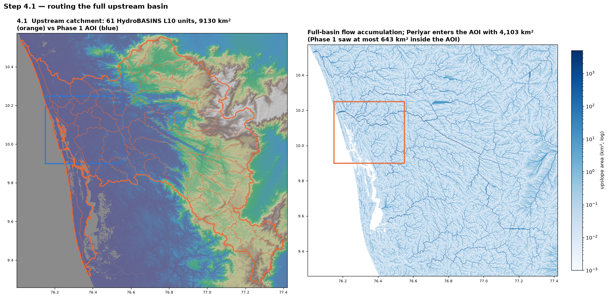
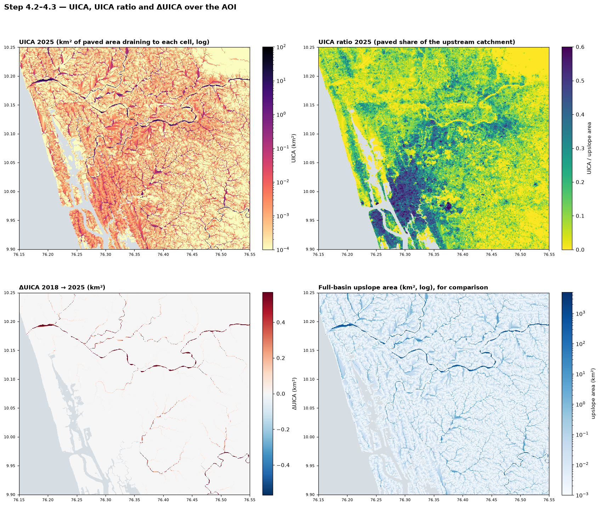
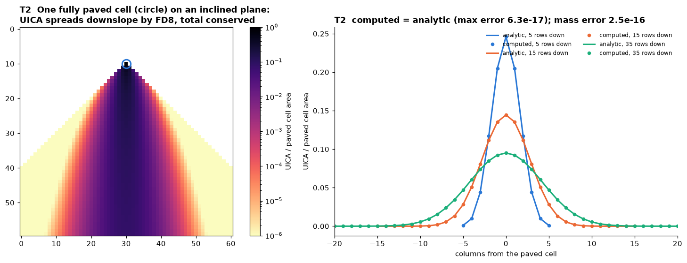
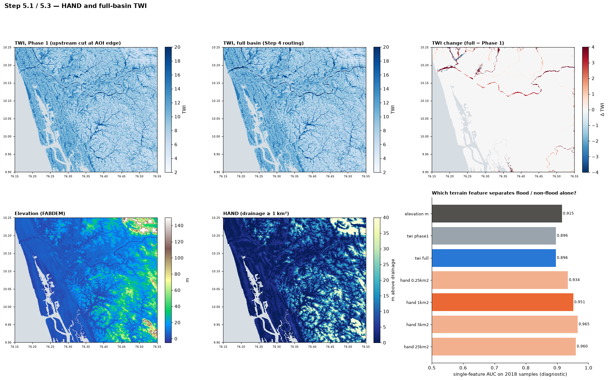
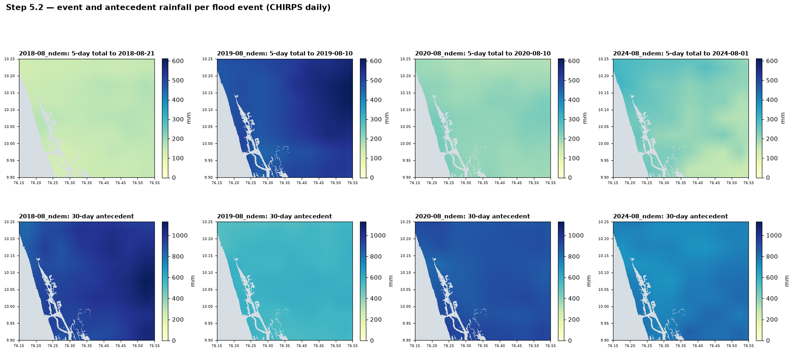
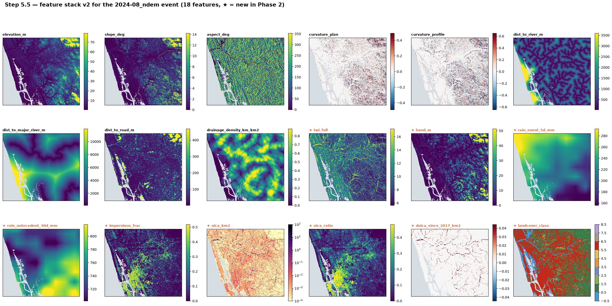
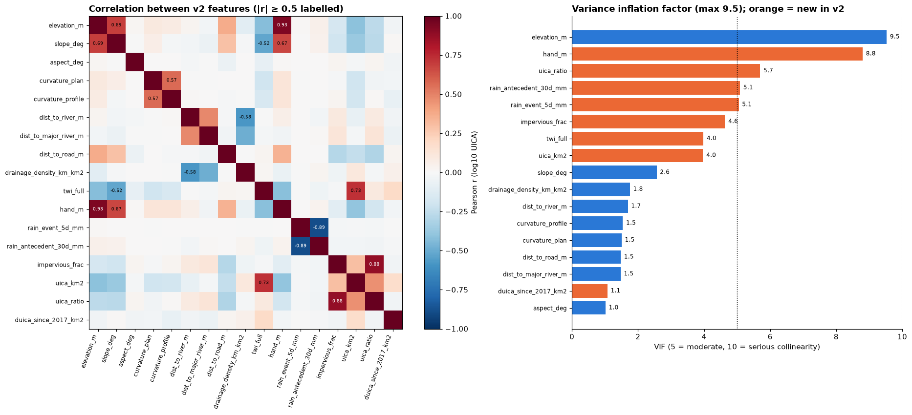
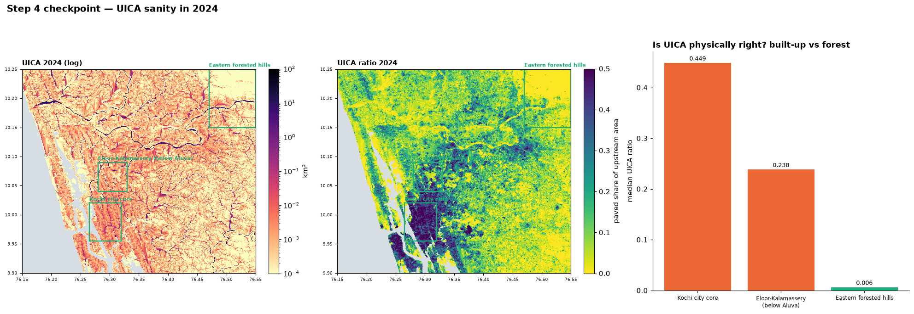

# Phase 2: Week 2 work, explained

**Project:** Development-aware flood susceptibility mapping, Lower Periyar (Aluva–Kochi), Kerala<br>
**Team 67:** Albin John, Niketh B Nath, Jatin Nath, R Ranjith Kumar · **Guide:** Dr. Rosebell Paul<br>
**Covers:** Phase 2 Step 4 (UICA and ΔUICA) and Step 5 (feature stack v2)

This document explains, in plain language, what we did in Week 2 of Phase 2, why we did it, and what came out. Every figure is an actual output of our scripts. Each section ends with the questions the guide is likely to ask, and their answers.

---

## 0. The big picture in one minute

At the end of Week 1 we had:

- a **map of paved (impervious) land for every year from 2017 to 2025**, and
- **4 verified flood events** (2018, 2019, 2020, 2024).

Week 2 turns these into **features the model can learn from**. The most important one is our project's main novelty:

> **UICA, the Upstream Impervious Contributing Area:** *"How much paved land drains into this spot?"*

A place can flood even if it is not paved itself, because the water arriving there comes from paved land upstream. UICA measures exactly that. **ΔUICA** measures how much it grew between two years, which is the "development" signal of our project.

| Step | Question it answers | Result in one line |
|---|---|---|
| **Step 4** | How much paved land drains into each 30 m cell, and how much did that grow? | UICA for every year 2017–2025 over a 9,130 km² catchment; **all 5 self-tests pass** |
| **Step 5** | What other features should the improved model get? | **HAND** (beats elevation: AUC 0.951 vs 0.915), event rainfall, full-basin TWI → **feature stack v2: 18 features × 4 flood events**, all checks pass |

---

## Words we use (glossary)

| Term | Simple meaning |
|---|---|
| **Catchment / basin** | All the land whose rainwater ends up flowing to a given place. |
| **Upslope (upstream) area** | For one cell: the total area of land that drains *into* it. Big along rivers, tiny on hilltops. |
| **Flow routing** | Computing, from the elevation map, where water from every cell flows. We use the same method as Phase 1 (Priority-Flood to remove fake pits, then FD8, which shares water among all lower neighbours). |
| **HydroBASINS** | A worldwide dataset that divides land into drainage basins and says which basin drains into which. |
| **UICA** | Upstream Impervious Contributing Area: km² of *paved* land that drains into a cell. |
| **UICA ratio** | UICA ÷ upslope area: the *share* of a cell's catchment that is paved (0 = all natural, 1 = all paved). |
| **ΔUICA** | UICA(later year) − UICA(earlier year): how much upstream paving grew. |
| **TWI** | Topographic Wetness Index: high where a lot of water arrives on flat ground. |
| **HAND** | Height Above Nearest Drainage: how many metres a place sits above the stream it drains to. 0–2 m means right next to the water level. |
| **AUC** | 0.5 = useless, 1.0 = perfect separation of flooded from dry places. |
| **VIF** | Variance Inflation Factor: how much one feature repeats information from the others. Above 10 is a problem. |

---

## Step 4: UICA, the upstream paved area

### 4.1 Why we first had to route the whole upstream basin

In Phase 1 we computed water flow **only inside our study box**. But the Periyar river starts far to the east in the Western Ghats, and all that upstream water was cut off at the box edge. In Phase 1, the largest catchment any cell saw was **643 km²**, while the Periyar actually carries water from about **4,081 km²** (HydroRIVERS) when it enters our area.

For UICA this matters even more: paved towns upstream (Perumbavoor, Kothamangalam, Thodupuzha and others) send their runoff into our area, so we must count them.

**What we did:**

1. **Found the full catchment.** Using HydroBASINS (level 10), we took the 19 basins touching our area, then followed the "which basin drains into which" links backwards. That gave **61 basins covering 9,130 km²**, about 5 times our study area.
2. **Downloaded the elevation map (FABDEM) for the whole catchment** on exactly the same pixel grid as Phase 1, so our study area sits inside it cell for cell. Check: the study-area part of the new map is **identical** to the Phase 1 map.
3. **Routed water over all 25.7 million cells,** with the same code as Phase 1, in 15 seconds. No pits remain, and water is conserved to 10⁻¹⁴.



*Left: the 61 upstream basins (orange) around our study area (blue box), over a shaded-relief map. Right: water accumulation over the whole basin; the Periyar is the dark line entering our box from the east.*

**Result:**

- **The Periyar now enters our area with 4,103 km²** of upstream land. The independent HydroRIVERS dataset says 4,081 km², so we are **within 0.5 %**.
- **The largest catchment inside our area is now 6,378 km²,** almost 10 times Phase 1's 643 km².
- Only **5 % of cells change**, exactly the river corridors. Everywhere else, Phase 1's numbers were already right.

### 4.2 Computing UICA

**The idea is simple.** Normal flow routing passes the *area* of each cell downhill and adds it up. For UICA we pass the **paved area** of each cell downhill instead.

```
paved area of a cell = impervious fraction (Step 2) × cell area
UICA of a cell        = its own paved area + all paved area flowing into it from upstream
UICA ratio            = UICA ÷ upslope area     (share of the catchment that is paved)
```

**Example.** A cell on the Periyar main stem receives water from 6,000 km² of land, of which 130 km² is paved. Its UICA is 130 km² and its UICA ratio is about 0.02 (2 %). A small drain in the middle of Kochi city receives water from 0.05 km², of which 0.025 km² is paved. Its UICA is tiny, but its UICA ratio is 0.5 (50 %). The ratio is what tells us *"this drain carries city runoff"*.

**Imperviousness for the whole catchment:**

- **Inside our area:** the exact Step 2 layer (Option A).
- **Outside it:** the same Option A formula (GHSL level + Dynamic World yearly change), built in Google Earth Engine. Inside the box, the two versions agree almost perfectly (r = 0.999).

We computed UICA for **every year from 2017 to 2025**.



*Top left: UICA 2025 (log scale); the dark lines are rivers carrying upstream paved area. Top right: UICA ratio, darkest over Kochi city. Bottom left: ΔUICA 2018 → 2025; the growth concentrates along drainage lines. Bottom right: plain upslope area, for comparison.*

| Year | Largest UICA in our area | Median UICA ratio | Top 10 % of cells have a ratio above |
|---|---|---|---|
| 2017 | 114.6 km² | 0.057 | 0.32 |
| 2018 | 118.9 km² | 0.064 | 0.32 |
| 2024 | 135.5 km² | 0.090 | 0.32 |
| 2025 | 132.9 km² | 0.089 | 0.32 |

### 4.3 ΔUICA: the development signal

```
ΔUICA = UICA(later year) − UICA(earlier year)
```

We computed it for three year pairs:

- **2018 → 2025:** the minimum the plan asks for;
- **2017 → 2025:** the whole record;
- **2018 → 2024:** between our first and last flood events.

| Pair | Largest increase | Top 1 % of cells increased by more than | Cells that increased |
|---|---|---|---|
| 2018 → 2025 | 15.1 km² | 0.15 km² | 55 % |
| 2017 → 2025 | 18.3 km² | 0.19 km² | 61 % |

The biggest increases are on the Periyar and on the drains below the fastest-growing areas (Kakkanad, the airport corridor, the Aluva fringe).

### 4.4 Self-tests: how we know UICA is computed correctly

The plan asked for four tests. We added one more, and **all five pass**:

| Test | What it checks | Result |
|---|---|---|
| **T1** | If we route "cell area" with the new UICA code, we must get exactly the old upslope area | difference 0.0 ✅ |
| **T2** | An artificial sloping plane with **one fully paved cell**: the computed spreading downhill must match the hand-calculated answer | error 6 × 10⁻¹⁷, i.e. exact ✅ |
| **T3** | UICA can never be negative, and never larger than the upslope area | 0 violations in 25.7 M cells, every year ✅ |
| **T4** | Where no paved cell exists upstream, UICA must be exactly 0 | 8.4 M such cells, all exactly 0 ✅ |
| **T5** | UICA must not decrease as we go downstream along a river | 0 violations ✅ (see note) |



*Test T2. Left: one paved cell (circle) on a sloping plane; its UICA spreads downhill. Right: our computed values (dots) lie exactly on the hand-calculated curves (lines).*

**A note on T5, because the guide may ask.** Our first, naïve version of T5 "failed": along the steepest path, UICA dropped at 30 % of river steps. We investigated and found that **plain upslope area drops at the same 30 %** of steps. The reason is that the FD8 method shares each cell's water among *several* lower neighbours, so one of them receives only *part* of it. That is how the method works, not a bug. We therefore wrote T5 as the exact statement FD8 guarantees:

- each downstream cell receives *at least its share* of the UICA;
- where the water is not split, UICA never drops.

Both hold everywhere.

### Likely questions

- **"Why did you need 9,130 km² when your study area is 1,697 km²?"** Water does not stop at our box edge. The Periyar brings runoff from about 4,100 km² of upstream land, including towns. Without the full basin, UICA would miss all upstream paving, and TWI would be too low along the rivers (a Phase 1 limitation we have now fixed).
- **"How do you know the routing is right?"** Three independent checks: (1) our Periyar inflow is within 0.5 % of HydroRIVERS; (2) the study-area part of the new map is identical to Phase 1; (3) water is conserved to 10⁻¹⁴, with no remaining pits.
- **"What is the difference between UICA and the UICA ratio?"** UICA is an *amount* (km² of paved land), which is big on large rivers. The ratio is a *share* (how urban the catchment is), which is high on city drains even when they are small. Both go to the model.
- **"Does it consider dams and canals?"** No. Routing follows the natural ground surface. The Idukki dam and its water transfer are not modelled; this is a stated limitation.

---

## Step 5: Upgrading the rest of the features

### 5.1 HAND: height above nearest drainage

**Idea:** a place 3 m above the nearest stream floods much more easily than a place 3 m above sea level but 20 m above its stream. **Raw elevation does not know about streams; HAND does.**

**How we computed it:**

1. **Where each cell drains.** From the full-basin routing, every cell's water follows the steepest path downhill.
2. **Find the first drainage cell.** The path stops at the first cell that is a stream (upslope area ≥ 1 km²) or open water.
3. **Measure the height.** HAND is the height difference between the cell and that drainage cell.

**Does it help?** We measured how well each feature *alone* separates the 2018 flooded and dry samples (AUC):

| Feature alone | All samples | Flat floodplain only (the hard cases) |
|---|---|---|
| Elevation | 0.915 | 0.764 |
| TWI (full basin) | 0.896 | 0.810 |
| **HAND** | **0.951** | **0.907** |

HAND is clearly better, and **the biggest gain is on the flat floodplain**, exactly where Phase 1 found elevation weak (Phase 1 Step 9).



*Top: TWI in Phase 1, TWI with the full basin, and the difference (changes only along rivers). Bottom: elevation, HAND, and the single-feature AUC comparison.*

**Honest note.** We fixed the drainage threshold at 1 km² *before* looking at results. A 5 km² threshold would score a little higher (0.965), but choosing it after seeing the labels would be cheating, so we kept 1 km².

### 5.2 Event rainfall instead of average rainfall

**Phase 1 problem:** the "mean annual rainfall" feature was the same every year. The model used it as a *location label* ("this corner of the map is wet"), not as rain. We showed this in Phase 1 Step 9.

**What we did:** for each flood event we computed, from CHIRPS daily rainfall:

- **5-day event rainfall:** the rain in the 5 days up to the satellite image;
- **30-day antecedent rainfall:** the rain in the 30 days before that. It tells us how wet the ground already was. Wet ground cannot soak up more water.

| Flood event | 5-day rain | 30-day antecedent | What it means |
|---|---|---|---|
| Aug 2018 | 155 mm | **971 mm** | Ground already soaked after weeks of extreme rain |
| Aug 2019 | **517 mm** | 572 mm | A very intense burst |
| Aug 2020 | 206 mm | 887 mm | Wet ground, moderate burst |
| Aug 2024 | 221 mm | 754 mm | Moderate |



*Top row: 5-day event rainfall per flood. Bottom row: 30-day antecedent rainfall. Same colour scale across events, so they can be compared.*

**Honest note.** For 2018, the 5-day window ends on the satellite date (21 Aug), so it misses the peak rain of 14–17 Aug. The 30-day total captures it. Rainfall changes mostly *between* events, not much *within* our area, because CHIRPS cells are about 5 km wide.

### 5.3 Other upgrades

- **TWI recomputed with the full basin:** it changes along the rivers only (5.8 % of cells). The "upstream cut-off" limitation from Phase 1 is fixed.
- **Impervious fraction** of each cell, for the event year (from Step 2).
- **Land-cover class** of each cell for the event year (Dynamic World: trees, built, crops, water and so on).
- **Soil texture (optional): not added.** The available soil map is too coarse (250 m, only a few classes).

### 5.5 Feature stack v2

We assembled everything into **one 18-feature stack per flood event** (2018, 2019, 2020, 2024). Development and rainfall features use **that event's year**.

| Group | Features |
|---|---|
| Kept from Phase 1 (9) | elevation, slope, aspect, plan curvature, profile curvature, distance to river, distance to major river, distance to road, drainage density |
| New terrain (2) | **TWI (full basin)**, **HAND** |
| New rainfall (2) | **5-day event rain**, **30-day antecedent rain** |
| New development (5) | **impervious fraction**, **UICA**, **UICA ratio**, **ΔUICA since 2017**, **land-cover class** |



*All 18 features for the 2024 event. Orange titles with ★ are new in Phase 2.*

**Quality checks (the same as Phase 1 Step 7.5): all pass.**

- **Same grid as Phase 1:** yes, all 4 stacks.
- **Gaps on land:** 0.
- **Values outside physical limits:** 0.
- **Repeated information (VIF):** maximum 9.5, below the danger level of 10.



*Left: how strongly each pair of features moves together. Right: VIF per feature (orange = new).*

**Pairs that move together (we will handle them in Week 3):**

- **Elevation and HAND (r = 0.93):** both measure "how high". HAND is the better one for floods. In Step 8 we will test the model with HAND instead of elevation, and with both.
- **Impervious fraction and UICA ratio (0.88):** a paved cell usually has a paved neighbourhood upstream.
- **5-day and 30-day rain (−0.89):** this only happens because we have 4 events. It is a coincidence of these years, not physics.

### Is UICA physically right? (the plan's checkpoint question)

The plan said: *"UICA must be high downstream of Kochi's built-up areas and near zero in forested catchments before any model uses it."*



*Median UICA ratio in three test areas (green boxes on the maps).*

| Area | Paved share of upstream catchment (median) | Tree cover |
|---|---|---|
| Kochi city core | **45 %** | 4 % |
| Eloor–Kalamassery (below Aluva) | **24 %** | 22 % |
| Eastern forested hills | **0.6 %** | 75 % |

**Yes.** UICA is high under the city, in the middle for the industrial belt, and near zero in the forest, exactly as it physically should be.

### Likely questions

- **"Why HAND and not just elevation?"** Floods in our area come from rivers rising. What matters is height *above the river*, not above the sea. HAND improved the hard flat-floodplain cases from 0.76 to 0.91 AUC.
- **"Why remove mean annual rainfall?"** In Phase 1 it acted as a map-position label, not as rain. Event rainfall changes from flood to flood, so it can describe *that* flood.
- **"Isn't VIF 9.5 too high?"** It is under 10, and it comes from elevation and HAND measuring similar things. We will compare models with and without elevation in Week 3 rather than drop a feature blindly.
- **"Why is 'built' 51 % in the land-cover class but impervious only 11 %?"** Dynamic World's "built" means *settlement area* (houses under trees). Impervious means *actual roofs and roads*. We explained this in Week 1 (Option A). Both are given to the model because they mean different things.

---

## What comes next (Week 3)

| Next step | Uses |
|---|---|
| **Step 6: fair evaluation framework.** 10 km spatial blocks plus a temporal hold-out (train on 2018 + 2019, test on 2020 and 2024); re-score the Phase 1 baseline the same way. | 4 events (Week 1), Phase 1 baseline (Week 0) |
| **Step 7: PU-learning.** Treat "not seen flooded" as *unlabelled*, not as "dry". | Stack v2 |
| **Step 8: model v2 and the development ablation** (Phase 1 → +hydrology → +land cover → +UICA/ΔUICA). This measures **how much UICA adds**. | Stack v2 (this week) |

---

## Suggested speaking split for the guide meeting

| Member | Part | Key numbers to remember |
|---|---|---|
| Member 1 | Big picture + 4.1 full-basin routing | 61 basins, 9,130 km²; Periyar 4,103 vs 4,081 km² (0.5 %); 643 → 6,378 km² |
| Member 2 | 4.2–4.3 UICA, UICA ratio, ΔUICA | UICA max 133 km² (2025); ΔUICA up to 15 km²; ratio 45 % city vs 0.6 % forest |
| Member 3 | 4.4 self-tests | 5 / 5 pass; T2 error 6 × 10⁻¹⁷; the T5 FD8 explanation |
| Member 4 | Step 5 (HAND, rainfall, stack v2) | HAND AUC 0.951 vs 0.915 (floodplain 0.907 vs 0.764); 18 features × 4 events; VIF 9.5 |

---

## Where everything is

| What | File |
|---|---|
| Step 4 script / numbers | `Phase 2/scripts/04_uica_full_basin.py` · `outputs/metrics/step4_uica.json` |
| Step 5 script / numbers | `scripts/05_feature_stack_v2.py` · `outputs/metrics/step5_feature_stack_v2.json` |
| Technical write-ups | `docs/step4_uica_full_basin.md`, `docs/step5_feature_stack_v2.md` |
| UICA rasters (all years) | `data/processed/uica/uica_km2_aoi.tif`, `uica_ratio_aoi.tif`, `duica_km2_aoi.tif` (regenerable) |
| Feature stack v2 | `data/processed/features_v2/stack_v2_<event>.tif` (regenerable) |
| Shared code (new: `d8_receiver`, `hand_from_receivers`) | `scripts/common.py`. The Phase 1 baseline check still passes 10 / 10 after the changes. |
