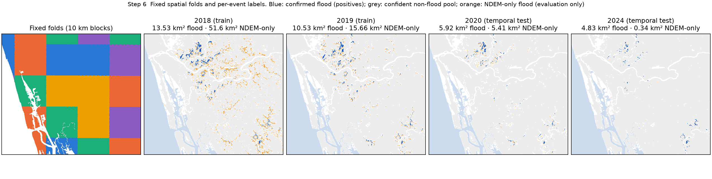
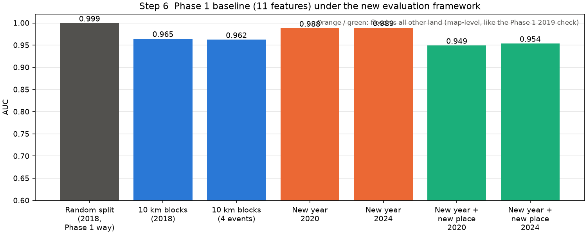
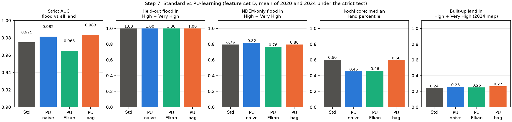
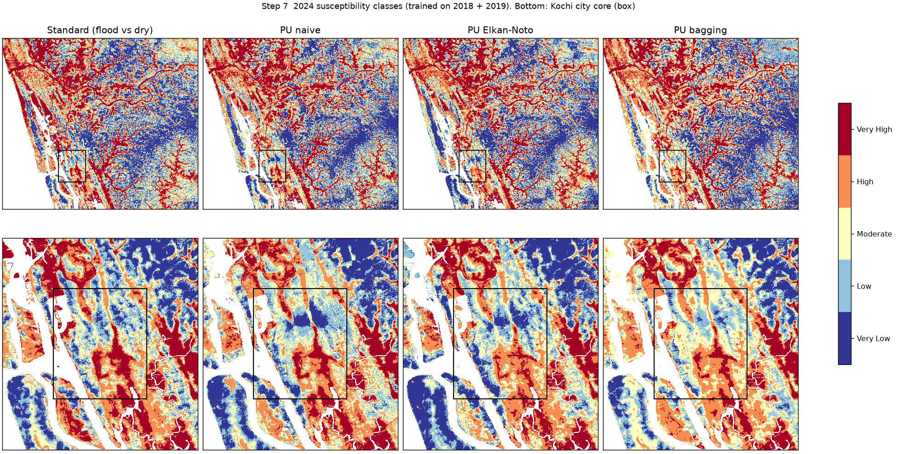
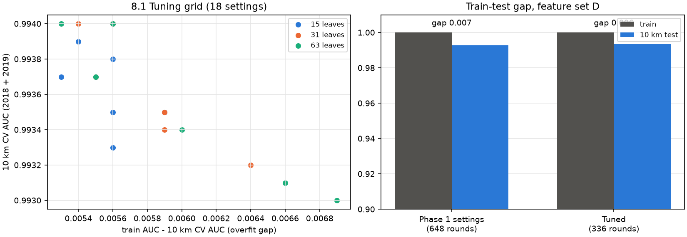
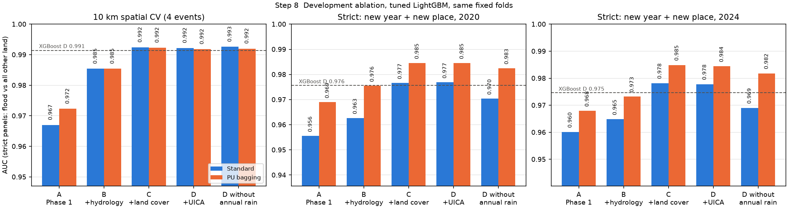
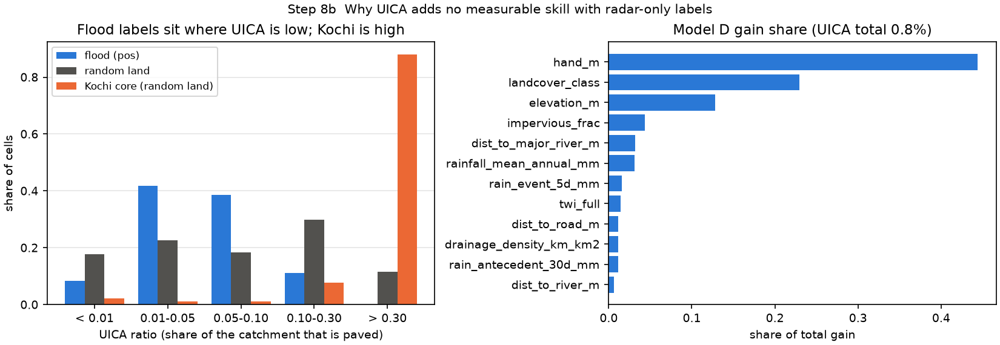
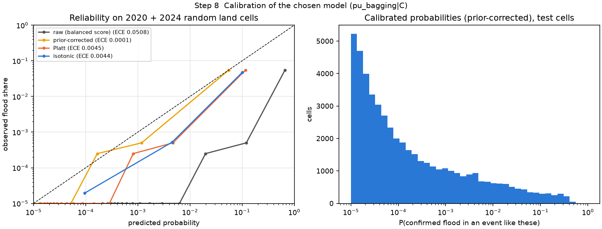
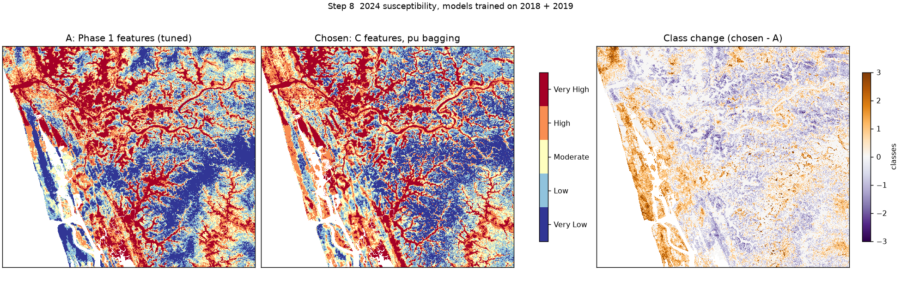

# Phase 2: Week 3 work, explained

**Project:** Development-aware flood susceptibility mapping, Lower Periyar (Aluva–Kochi), Kerala 
**Team 67:** Albin John, Niketh B Nath, Jatin Nath, R Ranjith Kumar · **Guide:** Dr. Rosebell Paul 
**Covers:** Phase 2 Step 6 (fair evaluation), Step 7 (PU-learning) and Step 8 (model v2, the development ablation, calibration)

This document explains, in plain language, what we did in Week 3 of Phase 2, why we did it, and what came out. Every figure is an actual output of our scripts. Each section ends with the questions the guide is likely to ask, and their answers.

---

## 0. The big picture in one minute

At the end of Week 2 we had **18 features for each of 4 verified flood events**, including our novelty, UICA. Week 3 answers three questions:

| Step | Question | Answer in one line |
|---|---|---|
| **Step 6** | How do we test a model *fairly*? | New test: train on 2018 + 2019, test on 2020 and 2024 **in places the model never saw**. Phase 1's model scores **0.949 / 0.954** there. That is the bar. |
| **Step 7** | Does treating "not seen flooded" as *unknown* instead of *dry* help? | Yes, a little. **PU bagging** is the best (0.984 vs 0.975). But it cannot fix Kochi city, because the satellite never sees city floods. |
| **Step 8** | Which new features really help? | Better hydrology and **land cover lift the strict AUC from 0.956 to 0.977** (0.985 with PU). **UICA adds nothing measurable yet.** We found out why: the flood labels never reach paved catchments. |

> **Honest headline:** the Phase 2 model is clearly better than Phase 1 on a much harder test (0.985 vs 0.956). Our main novelty (UICA) cannot prove itself with satellite-only flood labels. We show exactly why, and what data would fix it.

---

## Words we use (glossary)

| Term | Simple meaning |
|---|---|
| **AUC** | Probability that the model ranks a random flooded cell above a random non-flooded cell. 1.0 = perfect, 0.5 = guessing. |
| **Spatial block CV** | Cut the map into 10 km squares and test on squares the model never trained on. It stops the model "memorising the neighbourhood". |
| **Temporal hold-out** | Train on older floods (2018, 2019), test on newer ones (2020, 2024). |
| **Strict test** | Both at once: a **new year AND a new place**. Our main score from now on. |
| **Flood vs all land** | Harder AUC: flooded cells against *all* other land, including uncertain areas, not just clearly dry land. Like the Phase 1 2019 check. |
| **High + Very High (H + VH)** | The top 40 % of land by predicted risk (the Phase 1 five quantile classes). |
| **NDEM-only flood** | Land that the official NDEM map shows flooded, but that our single satellite pass saw as dry (it came before or after the peak). |
| **PU-learning** | Positive-Unlabelled learning. We know the *positives* (seen flooded); everything else is *unlabelled* (maybe flooded, maybe not), not "dry". |
| **Ablation** | Add one feature group at a time (A → B → C → D) and measure what each adds. |
| **Calibration** | Turning a model score into a real probability, e.g. "0.3 % chance". |
| **Location proxy** | A feature that helps only because it identifies *where* a cell is, not *why* it floods. It fools random tests and fails on new places. |

---

## Step 6: A fair test first

### 6.1 Dataset v2: one table for all models

For each of the 4 floods we applied **the same labelling rules as Phase 1**:
- **Flood** = confirmed by both the radar and NDEM.
- **Dry** = clearly away from any flood and water.

We also added:
- **60,000 random land cells** per event, the "unlabelled" set for PU-learning;
- **NDEM-only cells**, the flooding our satellite missed, used only for testing.

*Left: the 5 fixed test groups of 10 km squares. Then, for each flood: blue = confirmed flood, orange = NDEM-only flood, grey = confident dry land.*

| Flood | Confirmed flood | NDEM-only (missed) | Use |
|---|---|---|---|
| 2018 | 13.5 km² | 51.6 km² | train |
| 2019 | 10.5 km² | 15.7 km² | train |
| 2020 | 5.9 km² | 5.4 km² | test |
| 2024 | 4.8 km² | 0.3 km² | test |

**One number to remember: 0.1 % of the confirmed flood cells are built-up land, while 47 % of all land is built-up.** The radar cannot see water between buildings. This one fact explains most of Steps 7 and 8.

### 6.2–6.3 Three tests, the same for every model

The fold of every 10 km square is saved in a file, so **every model in Phase 2 is tested on exactly the same squares**. That makes comparisons fair.

| Test | Train | Test |
|---|---|---|
| Spatial | all 4 floods, 4 of 5 groups | the 5th group |
| Temporal | 2018 + 2019 | 2020, 2024 |
| **Strict** | 2018 + 2019, 4 groups | 2020, 2024, the 5th group |

### 6.4 The Phase 1 model under the new tests

*The same Phase 1 model, tested five ways.*

- **Random split: 0.999.** Too easy (the Phase 1 lesson).
- **New year only: 0.988 / 0.989.** Also too easy! The same fields flood every year, so a model that just remembers *where* past floods were looks great.
- **Strict (new year + new place): 0.949 / 0.954.** This is the honest number and **the bar every Phase 2 model must beat.**

### Likely questions

- **Why not just use the temporal test, as the plan said?** We ran it. It scores 0.99 because the floodplain is the same every year. Without the "new place" condition it rewards memorising locations, so we added the strict test.
- **Why is Phase 1's 10 km score now 0.965, not 0.979?** The folds are now fixed on all 4 events together, not on 2018 alone, and the 2018 flood map uses the corrected dry-season reference from Week 1. Same method, slightly different squares.
- **Why are the groups uneven?** The dense Aluva–Eloor floodplain falls in one 10 km square group. With 10 km squares this cannot be avoided; it is the price of a strict test.

---

## Step 7: PU-learning: "not seen flooded" is not "dry"

### The idea

Phase 1 called everything outside the radar flood "dry". But:
- the satellite passes once, often after the peak (NDEM-only flood);
- it cannot see urban flooding.

So some "dry" cells were really flooded. PU-learning treats them as **unknown**. We compared four ways, with the same features (set D) and the same squares:

| Method | How it works |
|---|---|
| Standard | flood vs confident dry (Phase 1 design) |
| PU naive | flood vs random land, no correction |
| PU Elkan–Noto | estimates how often a real flood gets labelled (*c*) and rescales |
| **PU bagging** | 25 small models, each: all floods + a different random handful of land; averaged |

*Strict test, average of 2020 and 2024.*

### What came out

| | Standard | PU bagging |
|---|---|---|
| Strict AUC, flood vs all land | 0.975 | **0.984** |
| Held-out flood in the Very High class | 99 % | 99.9 % |
| Missed (NDEM-only) flood in H + VH, 2020 | 62 % | 63 % |
| Kochi city: median risk percentile | 60 | 60 |

*2024 risk classes from each method. Bottom row: zoom on Kochi city (box).*

- **PU bagging is the best**, and we use it from now on.
- **Kochi city does not rise.** PU can only raise places that *look like* the known floods. Our known floods are 0.1 % urban, so the model has nothing urban to learn from.
- Elkan–Noto estimates that about **7 % of land** is flood-prone, against 0.3–0.9 % seen flooded in any one pass. That fits the much larger NDEM peak maps.

### Likely questions

- **Did PU fix the urban blind spot?** No, and we can say why. PU fixes *missing* labels of the kind we have; it cannot invent a kind of flood we never saw. It needs urban flood examples (Phase 3).
- **Why is Elkan–Noto worse?** It trains on fewer positives (20 % held out to estimate *c*) without class balancing. Its value is the *c* estimate, not the ranking.

---

## Step 8: Which features really help?

### 8.1 Tuning

We tried 18 LightGBM settings, tuning **only on 2018 + 2019** so the test years stay unseen. All 18 scored between 0.993 and 0.994. **The settings hardly matter**; the data limit the model.

*Left: the 18 settings. Right: train vs test AUC before and after tuning.*

### 8.3 The ablation: the key result of the week

*Each model adds one group of features. Blue = standard, orange = PU bagging. Dashed line = XGBoost.*

| Model | Adds | Strict AUC (PU bagging, 2020 / 2024) |
|---|---|---|
| A | Phase 1 features | 0.969 / 0.968 |
| B | HAND, full-basin TWI, event rainfall | 0.976 / 0.973 |
| **C** | **impervious fraction, land cover** | **0.985 / 0.985** |
| D | UICA, UICA ratio, ΔUICA | 0.985 / 0.984 |

- Better **hydrology** and **land cover** give real gains on new years and new places.
- **PU bagging beats the standard design for every feature set.**
- **D equals C: UICA adds nothing measurable.**
- XGBoost does no better than LightGBM, so the model type is not the problem.
- On a random split *all* models score 0.999. Only the strict test shows the differences.

### 8b Why UICA does not help (yet)

*Left: UICA ratio of the flood labels (blue), random land (grey) and Kochi city (orange). Right: how much model D uses each feature.*

| | Flood labels | Kochi city |
|---|---|---|
| Median UICA ratio | 0.05 | **0.45** |
| Median paved fraction | 0.00 | 0.43 |

- The radar floods sit in rice fields and riverbanks, where UICA is about 0.
- UICA is large in the city, where the radar never sees floods.
- So the model cannot learn anything from UICA: it uses UICA for only **0.8 %** of its decisions.

**This is a limit of the labels, not of UICA.** UICA was shown to be physically right in Week 2. To test it properly we need **urban flood labels**: SAR double-bounce, NDEM urban polygons, or reported waterlogging points.

### 8.4 Calibration: from score to probability

*Left: predicted vs observed flood share on the 2020 and 2024 test land (the dashed line is perfect). Right: the calibrated probabilities.*

- The raw score says 5.4 % on average; reality is 0.37 %.
- After **prior correction** (undoing the 50/50 balanced training) it says 0.38 %, close to reality.
- Platt and isotonic scaling learned the size of the 2018/2019 floods (twice as big as 2020/2024), so they over-predict.

**Lesson:** a flood probability depends on how big the event is. Week 4 should tie it to the event rainfall.

### 2024 map: Phase 1 features vs the chosen model

*Left: Phase 1 features. Middle: chosen model (PU bagging, set C). Right: class change.*

The chosen model is sharper along rivers and the floodplain. But it rates built-up land lower: 23 % of built land in H + VH, against 29 % for Phase 1. It learned "built = not flooded" from the radar labels. **Any map shown to planners must state this.**

### Likely questions

- **So is UICA useless?** No. It was never given a fair chance: none of our labels are urban floods. It stays in model D for the Week 4 development scenarios, and testing it with urban labels is the top Phase 3 item.
- **Isn't 0.985 suspiciously high?** It is flood vs all land, in new years *and* new places. But the floods are mostly the same kind (open-field river flooding near the big rivers), which is easier to predict than city waterlogging. We say so.
- **Why keep mean annual rainfall if it is a location proxy?** Removing it costs 0.007 on the strict test, so it still carries some real information about where floods happen. We keep it and flag it; Week 4 SHAP will show how it is used.
- **Did tuning reduce over-fitting?** Only slightly (gap 0.0071 → 0.0065). Training AUC is still about 1.0, because confident dry cells are very easy to separate. The honest test is the strict one, not the gap.

---

## What comes next (Week 4)

| Next step | Uses |
|---|---|
| **Step 9: current vs post-development maps.** Change paving (GHSL 2030 / trend / planner scenario) and recompute risk. | Model D and C, Step 2 paving |
| **Step 10: natural experiment.** Where paving grew 2017 → 2024, did flooding change? | 4 events, ΔUICA |
| **Step 11: SHAP explanations.** Which features drive each cell's risk; check the annual-rainfall proxy. | Chosen model |

---

## Suggested speaking split for the guide meeting

| Member | Part | Key numbers to remember |
|---|---|---|
| Member 1 | Big picture + Step 6 (fair tests) | Phase 1: 0.999 random → 0.988 new year → **0.949 / 0.954 strict**; 0.1 % of floods are urban |
| Member 2 | Step 7 PU-learning | PU bagging 0.984 vs 0.975; Kochi stays at the 60th percentile; Elkan *c* = 0.17 (about 7 % of land flood-prone) |
| Member 3 | Step 8 ablation | A 0.969 → B 0.976 → **C 0.985** → D 0.985; XGBoost 0.976; tuning range 0.993–0.994 |
| Member 4 | 8b UICA diagnosis + calibration | UICA ratio: floods 0.05, Kochi 0.45; 0.8 % of gain; prior-corrected 0.38 % vs 0.37 % observed |

---

## Where everything is

| What | File |
|---|---|
| Step 6 script / numbers | `Phase 2/scripts/06_eval_framework.py` · `outputs/metrics/step6_eval_framework.json`, `step6_fold_assignment.json` |
| Step 7 script / numbers | `scripts/07_pu_learning.py` · `outputs/metrics/step7_pu_learning.json` |
| Step 8 scripts / numbers | `scripts/08_model_v2_ablation.py`, `08b_uica_diagnostics.py` · `outputs/metrics/step8_model_v2_ablation.json`, `step8b_uica_diagnostics.json` |
| Models (trained on 2018 + 2019) | `outputs/models/model_v2_A.txt`, `model_v2_C.txt`, `model_v2_D.txt` |
| Technical write-ups | `docs/step6_eval_framework.md`, `docs/step7_pu_learning.md`, `docs/step8_model_v2_ablation.md` |
| Dataset v2 (regenerable) | `data/processed/training_v2/samples_v2.parquet`, `label_pools_<event>.tif` |
| Shared code (new Week 3 section: label pools, folds, test protocols, PU models) | `scripts/common.py`. The Phase 1 baseline check still passes 10 / 10. |
