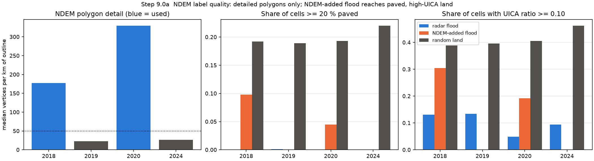
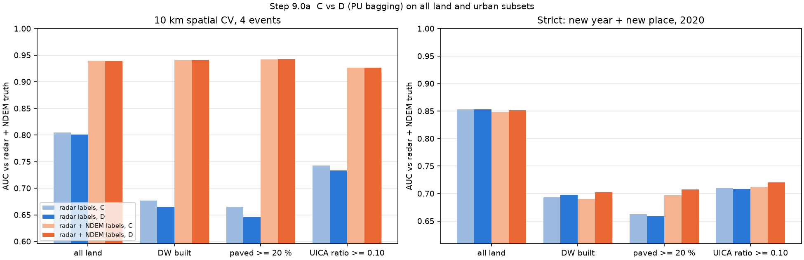
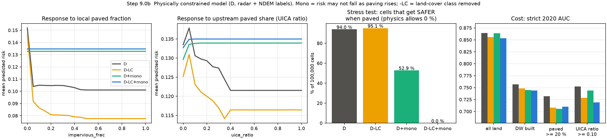
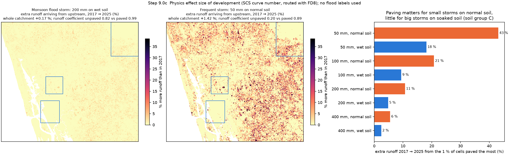
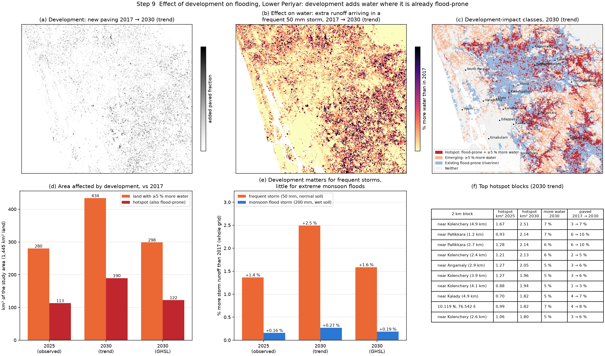
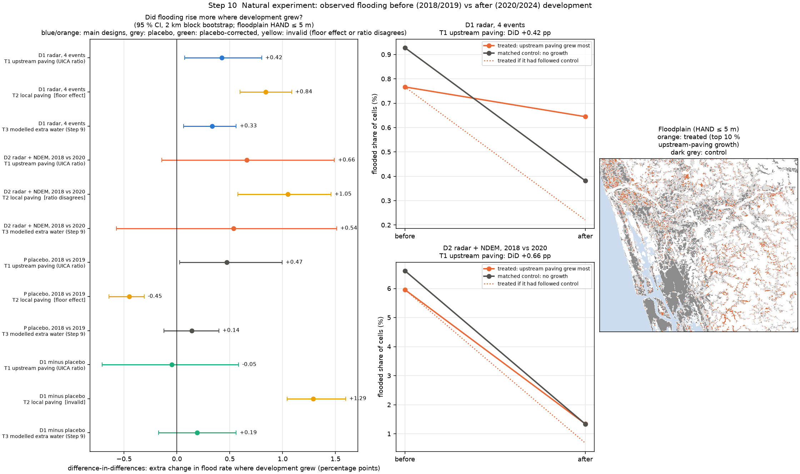
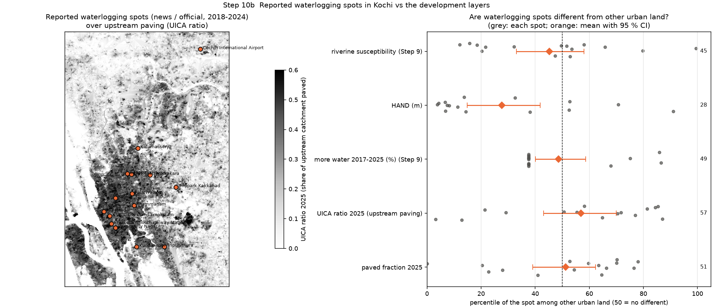
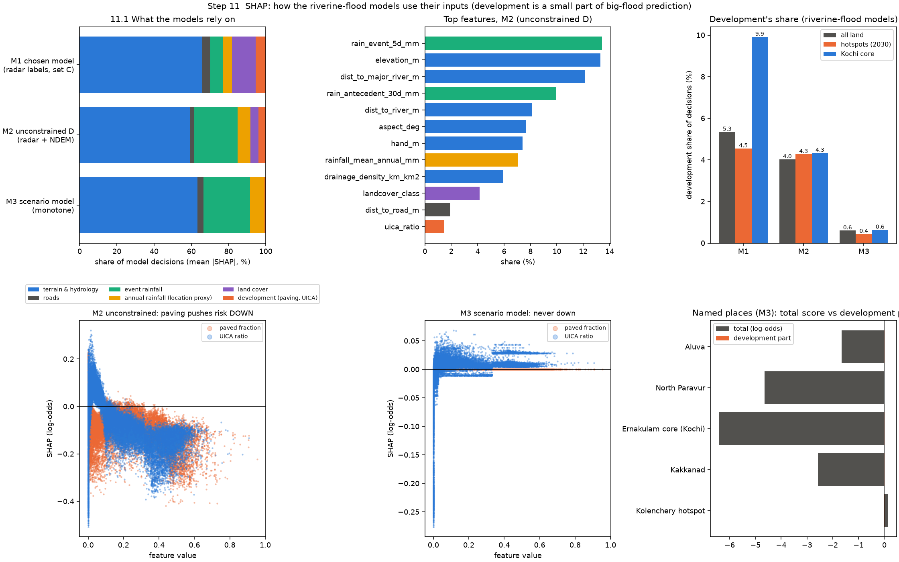
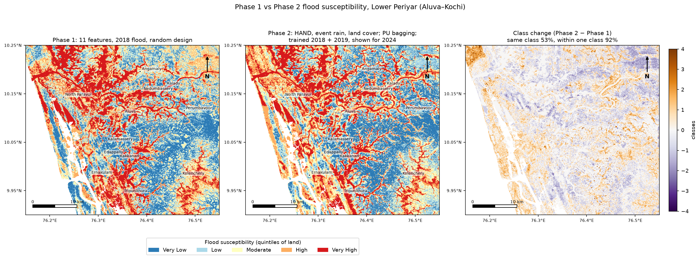

# Phase 2: Week 4 work, explained

**Project:** Development-aware flood susceptibility mapping, Lower Periyar (Aluva–Kochi), Kerala 
**Team 67:** Albin John, Niketh B Nath, Jatin Nath, R Ranjith Kumar · **Guide:** Dr. Rosebell Paul 
**Covers:** Step 9.0 (fixing the development blind spot), Step 9 (current vs post-development), Step 10 (natural experiment), Step 10b (waterlogging check), Step 11 (SHAP)

This document explains, in plain language, what we did in Week 4, why we did it, and what came out. Every figure is an actual output of our scripts. Each section ends with the questions the guide is likely to ask, and their answers.

---

## 0. The big picture in one minute

Week 3 ended with a problem: our main idea, UICA (paved land upstream), **did not improve the model at all**. Week 4 found out why, fixed what could be fixed, and measured the effect of development in other ways.

| Step | Question | Answer in one line |
|---|---|---|
| 9.0a | Why did UICA show nothing? | Satellite flood maps do not show towns flooding. With ISRO's NDEM maps added, UICA **does help on built-up land** (one test year). |
| 9.0b | Can the model be trusted for "what if we build here"? | Not as it was: it said building makes **94 %** of places safer. With a physical rule: **0 %**. |
| 9.0c | How much more water does development send? | Big monsoon storm: **+0.2 %**. Everyday heavy rain: up to **+40 %** on newly paved land. |
| 9 | What is the effect of development by 2030? | Flood-prone land getting ≥ 5 % more water: **113 km² now → 190 km² by 2030**, mostly from paving upstream. |
| 10 | Did real floods change where development grew? | **No change in the big floods**, as the physics predicts. |
| 10b | Do real waterlogging spots fit our idea? | 15 news-reported spots in Kochi sit in low land **below more paved land**: a first hint, not yet proof. |
| 11 | What does the model rely on? | Terrain about 60–66 %; development about 4–5 %. |

> **Honest headline:** development hardly changes the big river floods, but it adds a lot of water in everyday heavy rain, mostly from paving upstream. We can show this by physics and see a first hint in real waterlogging reports. Proving it properly needs waterlogging data (Phase 3).

---

## Words we use (glossary)

| Term | Simple meaning |
|---|---|
| **NDEM** | ISRO's official flood maps. Some of them include flooding in town areas that our satellite radar cannot see. |
| **Label** | The "answer" we train on: flooded or not flooded at a place. |
| **Monotone rule** | A rule we give the model: more paving can only keep risk the same or raise it, never lower it. |
| **SCS curve number** | A standard engineering formula (used for drain design) that says how much rain runs off the ground, given soil and paving. |
| **Frequent storm** | Ordinary heavy rain (about 50 mm) on normal ground, the kind that causes waterlogging every year. |
| **Hotspot** | Land that is already flood-prone **and** is getting at least 5 % more water because of development. |
| **Natural experiment** | Comparing places that were developed with similar places that were not, before and after. |
| **Placebo check** | Running the same test where no effect should exist, to see if the method fools itself. |
| **SHAP** | A method that shows which inputs pushed the model's score up or down at each place. |

---

## Step 9.0a: Why UICA showed nothing, and a fairer test

**The cause.** Sentinel-1 radar cannot see water between buildings. So in our flood examples, **only 0.1 % are built-up land**, while 47 % of all land is built-up. The model never saw a town flooding, so it could not learn anything from paving.

**The fix we tried.** ISRO's NDEM maps also mark flooding our radar missed, and some of it is in town areas. We checked the NDEM outlines first:
- 2018 and 2020 are drawn in fine detail, so we used them;
- 2019 and 2024 are rough shapes, so we dropped them.

*Left: how detailed each year's NDEM outlines are. Middle and right: the NDEM-added flooding reaches paved land, which the radar flooding never does.*

*Model scores on all land and on built-up land, with and without UICA (C vs D), for radar-only labels and radar + NDEM labels.*

**Result.** With NDEM labels, on a new year and a new place (2020), the model with UICA is better on built-up land:
- paved land: +0.037;
- built-up land: +0.015.

Both confidence ranges are above zero. With radar labels alone there was no gain.

### Likely questions
- **Why only 2020 for the test?** It is the only test year with detailed NDEM outlines. 2024's outlines are too rough to use.
- **Is +0.037 a lot?** It is small but consistent, and it appears only where it should: on paved land.

---

## Step 9.0b: A physical rule for the model

The model had learned "built-up = dry". We tested it by "building" on 100,000 open plots on paper.

*Left two panels: how risk responds to paving. Before the rule it falls; after the rule it is flat or rising. Third panel: share of plots that became "safer" when paved. Right: the accuracy cost.*

| Model | Plots "safer" after building |
|---|---|
| Normal model | **94 %** |
| Rule on paving only | 53 % (the built-up land-cover label still carried the bias) |
| **Rule + no land-cover label** | **0 %** |

**Accuracy cost:** 0.864 → 0.854. The fixed model's response to paving is almost flat. The rule stops the wrong answer, but it cannot create an effect the labels never showed. So **the size of the development effect has to come from physics**.

### Likely questions
- **Isn't a rule "cheating"?** No. Paving physically cannot make water soak in better. Hydrologists use such rules routinely.
- **Why accept a cost of 0.011 when you planned a limit of 0.01?** The lost accuracy came from the label bias itself, and the alternative gives wrong future maps.

---

## Step 9.0c: Physics: how much more water?

We used the SCS curve number formula to compute, for every 30 m cell, how much rain runs off with 2017 paving and with 2025 paving. Then we sent the extra water downhill through the drainage network.

*Left: big monsoon storm. Middle: frequent storm. Right: how the result depends on rain amount and soil wetness.*

| | Big monsoon storm (200 mm, soaked soil) | Frequent storm (50 mm, normal soil) |
|---|---|---|
| Unpaved land sheds | 82 % of the rain | 20 % |
| Paved land sheds | 99 % | 89 % |
| Extra water, whole catchment | +0.2 % | +1.4 % |
| Newly paved spots | +5 % | **+43 %** |

**Why?** In a big flood the ground is already soaked, so paving changes little. In ordinary heavy rain the soil still acts like a sponge, and paving removes that sponge.

### Likely questions
- **Which soil did you assume?** One soil type (group C) for the whole basin, because no detailed soil map can be downloaded. Other soil types change the numbers by about 2×, not the pattern.
- **Are drains included?** No, so the numbers are an upper bound where drainage is good.

---

## Step 9: The effect of development, now and in 2030

We built four paving scenarios:
- **2017**;
- **2025** (current);
- **2030 trend:** each place keeps paving at its own recent pace;
- **2030 GHSL:** the official European projection.

For each one we produced two layers:
- **Layer A:** where the big floods go (the rule-bound model).
- **Layer B:** how much more water arrives in a frequent storm (physics).

*(a) New paving 2017 → 2030. (b) Extra water arriving in a frequent storm. (c) Hotspots: flood-prone land getting ≥ 5 % more water. (d)–(f) The numbers and the worst places.*

| | 2025 | 2030 trend | 2030 GHSL |
|---|---|---|---|
| Land with ≥ 5 % more water | **280 km²** | **434 km²** | 299 km² |
| **Hotspots** (flood-prone + more water) | **113 km²** | **190 km²** | 122 km² |
| Share of the extra water from **upstream** paving | 87 % | 100 % | 88 % |
| Big-flood map: land moving up a class | 1.1 % | 1.2 % | 1.3 % |

The worst places are the **growing eastern suburbs**: near Kolenchery, Pallikkara (Kakkanad side), Angamaly and Kalady. The Kochi core shows no extra water, because it was already paved before 2017. The trend also holds at 2 % and 10 % thresholds.

### Likely questions
- **Why do most of the effects come from upstream?** Water from paved land flows downhill, so a place gets the runoff of everything above it. This is exactly what UICA measures.
- **How sure is the 2030 number?** It depends on how fast building continues: 299–434 km² of land with more water.

---

## Step 10: Did real floods change? (natural experiment)

**What we did:**
- We compared the floods before (2018, 2019) and after (2020, 2024).
- **Developed places:** the 10 % of floodplain cells whose upstream paving grew the most.
- **Comparison places:** similar places with no growth.
- We also ran a **placebo check**: 2018 vs 2019, before most of the growth. No "effect" should appear there.

*Left: all estimates with 95 % ranges. Blue/orange: main tests. Grey: placebo. Green: placebo-corrected. Yellow: invalid. Middle: flood rate before and after. Right: the compared places.*

**Results:**
- The simple estimate looked positive (+0.42 points), but the **placebo showed the same (+0.47)**. The places that would later be developed already behaved differently.
- After correcting: **−0.05 points** (range −0.7 to +0.6). **No effect.**
- The local-paving test was invalid: radar never sees floods on paved land.

This fits the physics: development adds only +0.2 % water in big storms, far below what four floods can detect (about 0.5 points).

### Likely questions
- **So development has no effect?** On the big river floods, no measurable effect, as physics predicts. The effect is in everyday waterlogging, which satellites do not record.
- **What does the placebo do?** It catches a fake result. Without it we would have reported +0.42 as an effect.

---

## Step 10b: Real waterlogging reports

**What we did.** We searched news and official reports and found **15 places in Kochi reported waterlogged**, mainly in:
- the **21 Oct 2019** downpour (about 20 cm in 4 hours);
- the **28 May 2024** cloudburst.

We located each one on the map (OpenStreetMap) and compared it with other urban land.

*Left: the 15 spots over upstream paving. Right: where each spot ranks among other urban land (50 = no different).*

| Check | Result |
|---|---|
| Height above stream | **28th percentile**: the spots are low-lying (significant) |
| **Upstream paving (UICA)** | **57th–61st percentile**; 11 of 15 spots above average; the old-city spots at the 70th–87th |
| Paving growth since 2017 | 49th: no difference (the waterlogged spots are in the old, already-paved city) |
| Big-flood model score | 45th: it does not flag waterlogging spots |

**Meaning:** real waterlogging happens in low spots below heavily paved land. That is **the first real-world hint for UICA**. With only 15 spots it is not statistically strong yet (p ≈ 0.08–0.19).

### Likely questions
- **Why trust news reports?** They are used only as locations, each with a source link. The weakness is that only well-known places get reported.
- **Why doesn't the growth layer match?** The reported spots are in the old city, which was paved before 2017. New growth areas have few reports so far.

---

## Step 11: What the model relies on (SHAP)

SHAP explains **the model**. The model was trained on big river floods, so this tells us how it predicts **those**, not waterlogging.

*Top: share of each input group in three models, and development's share. Bottom: how paving affects the score (falling in the normal model, never falling in the rule-bound one), and five named places.*

| | Chosen model | Normal model + NDEM | Rule-bound model |
|---|---|---|---|
| Terrain and hydrology | 66 % | 59 % | 63 % |
| Event rainfall | 7 % | 23 % | 25 % |
| **Development** | **5.3 %** | **4.0 %** | **0.6 %** |

- The normal models learned "more paving → less flooding" (correlation −0.9).
- The rule-bound model gives upstream paving the correct direction (+0.6).

### Likely questions
- **Development is only 5 %. Is the project title wrong?** For big river floods, development really is a small factor, and now we have a number. Its importance is in water volume during everyday storms (Step 9), not in the river-flood map.

---

## Step 12 (started): Final maps and deck

The final maps, with legend, scale bar and north arrow, plus the headline tables and the Phase 2 deck, are ready (see "Where everything is").

| Test | Phase 1 model | Phase 2 model |
|---|---|---|
| Random split | 0.999 | 0.999 |
| Unseen 10 km regions | 0.962 | 0.992 |
| **New year + new place** | **0.949 / 0.954** | **0.985 / 0.985** |

---

## What comes next

- **Week 5 (Step 13):** Phase 2 summary, limitations note, Phase 3 list.
- **Phase 3, Work Package 1:** prove the development effect with real waterlogging data:
  - Kochi waterlogging records;
  - radar detection of flooding between buildings;
  - paddy and wetland loss;
  - more flood events.

---

## Suggested speaking split for the guide meeting

| Member | Part | Key numbers to remember |
|---|---|---|
| Albin | Big picture, 9.0a, 9.0b | 0.1 % urban labels; +0.037 on paved land; 94 % → 0 % "safer" |
| Niketh | 9.0c physics, Step 9 | +0.2 % vs +43 %; 280 → 434 km²; hotspots 113 → 190 km²; 87 % from upstream |
| Jatin | Step 10, Step 10b | placebo +0.47; corrected −0.05; 15 spots; HAND 28th, UICA 57th–61st percentile |
| Ranjith | Step 11, Phase 1 vs 2, Phase 3 plan | terrain about 63 %, development 4–5 %; strict test 0.95 → 0.985 |

---

## Where everything is

| What | File |
|---|---|
| Scripts | `Phase 2/scripts/09a_ndem_labels.py`, `09b_constrained_model.py`, `09c_extra_runoff.py`, `09_dual_prediction.py`, `10_natural_experiment.py`, `10b_waterlogging_check.py`, `11_shap_explanations.py`, `12_phase2_maps.py`, `12b_build_phase2_deck.py` |
| Technical write-ups | `docs/step9a_ndem_labels.md`, `step9b_constrained_model.md`, `step9c_extra_runoff.md`, `step9_dual_prediction.md`, `step10_natural_experiment.md`, `step10b_waterlogging_check.md`, `step11_shap.md`, `step12_final_outputs.md` |
| Final maps | `outputs/maps/step12_map_*.png`, `step12_architecture_status.png`, `step12_headline_tables.png` |
| Phase 2 deck | `outputs/presentation/BTP Phase 2 Team 67.pptx` (22 slides, official template) |
| Waterlogging data and sources | `data/raw/waterlogging/` |
| References for the report | `docs/references_phase2.md` |
